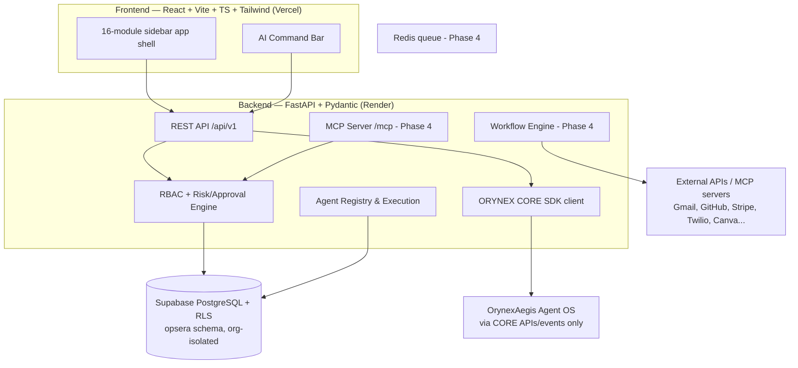

# OrynexOpsera — Architecture (Phase 1 foundation, 2026-11-06)

## Finding from inspection
No existing OrynexOpsera repo exists in the workspace or on GitHub (chinmaystudio has neuroclass + neuroclass_app only). This is a greenfield build. Stack follows the master spec §10, reusing Chinmay's existing Supabase project pattern (separate project recommended for Opsera; migrations are project-agnostic).

## System diagram (text / Mermaid)


## Rules enforced in code
- Never access another ORYNEX app's DB. Cross-app = CORE APIs/MCP/events only.
- Every table: organization_id + RLS. Credentials encrypted, never in frontend-accessible tables (vault table, service-role only).
- Risk levels LOW/MEDIUM/HIGH/CRITICAL (§11): HIGH+ requires approval_requests row; CRITICAL (payments, deletes) never auto-executed by agents.
- No fake integrations: an integration without credentials reports status `not_configured`, never `connected`.

## Repo layout
```
orynex-opsera/
  docs/        plan, architecture, DB design, integration inventory, API/MCP docs
  frontend/    React+Vite+TS+Tailwind app (16 modules, Phase 1: shell + Command Center + real API wiring for orgs/departments/tasks)
  backend/     FastAPI app (auth stub via Supabase JWT, RBAC, CRUD, agent registry, approvals, audit)
  supabase/migrations/  opsera schema, all core entities §9 + creative/engineering extensions, RLS
```
